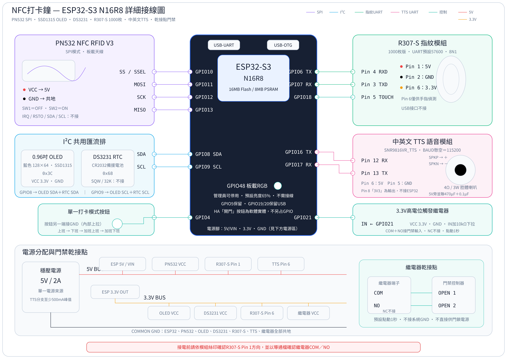

# 單按鍵 NFC＋指紋打卡鐘 v2.1.8

以 **ESP32-S3 N16R8、PN532 與 R307-S** 製作的 ESPHome 打卡鐘，搭配 OLED 顯示、語音提示與門禁繼電器。透過 **一顆 GPIO4 按鍵**循環切換「上班 → 下班 → 加班上班 → 加班下班」，也可從管理網頁或 Home Assistant 切換。

裝置提供獨立的 Web 管理介面，日常打卡與管理不依賴 Home Assistant。本版使用 16MB Flash 保存資料，PSRAM 停用；R307-S 1000 枚指紋模組為選配。

## 下載與開始使用

- [下載 v2.1.8 完整原始碼 ZIP](https://github.com/shihkefa/ESP32S3-NFC-Fingerprint-Attendance-Clock/blob/main/releases/v2.1.8/nfc-attendance-clock-s3-v2.1.8.zip?raw=true)
- [ESPHome 燒錄教學：複製哪些檔案、設定密碼、USB 與 OTA](./docs/ESPHOME_FLASHING.md)
- [下載高解析度接線圖](./images/nfc-attendance-esp32s3-detailed-wiring.png?raw=true)
- [檔案校驗碼](https://github.com/shihkefa/ESP32S3-NFC-Fingerprint-Attendance-Clock/blob/main/releases/v2.1.8/SHA256SUMS.txt) · [整理與驗證範圍](./docs/VALIDATION.md)

此倉庫提供可自行編譯的原始碼。請使用自己的 Wi-Fi 與管理員密碼編譯，沒有附預先編譯的 BIN。

## v2.1.8 功能

- NFC 與指紋共用四種打卡模式；單按鍵、管理網頁及 Home Assistant 均可切換。四種模式可分別設定每日自動切換排程。
- 最多 500 位員工，每人可綁定一張 NFC 卡、兩枚指紋，以及是否允許開門。
- NFC 支援感應登記及手動輸入 4-byte／7-byte UID，接受連字號、冒號、空格或連續十六進位字元，保存前會檢查管理員密碼與重複卡號。
- 感應登記卡片時播報「請將新卡靠近感應區」，成功後播報「卡片已登記」，管理頁隨即更新卡號。
- 管理員可補登最近兩個日曆月內、且不晚於裝置目前時間的打卡。紀錄標記為「管理員補登」，納入統計與匯出，不觸發語音、燈號或開門。
- 最多 5000 筆每日請假／出勤備註；打卡紀錄保留目前日期往前兩個日曆月，環形區達容量水位後循環覆蓋較早資料。
- SSD1315 OLED 顯示時間、模式與打卡狀態；DS3231 提供離線計時，連網後使用 SNTP 校時。
- TTS 播報員工編號與打卡結果；已授權員工可驅動 GPIO21 門禁繼電器一秒。
- 管理後台包含總覽、打卡紀錄、統計分析、員工、每日備註、設定及說明。
- CSV、Excel 匯出與完整 JSON 備份／還原。Excel 含出勤彙總及員工獨立分頁。
- 「清空全部指紋」會在確認 R307-S 清空成功後，再移除員工指紋 ID 對應。

**指紋模板本體保存在 R307-S 模組內。** JSON 備份保存員工與實際模板 ID 的對應，不含指紋模板；同一顆模組可沿用，更換全新的 R307-S 後需重新登記指紋。

## 透過 ESPHome 燒錄，要複製哪些檔案？

將 `nfc-attendance-clock.yaml`、`attendance_partitions_s3.csv` 與完整 `components/` 資料夾放到 ESPHome 設定目錄。**兩個元件資料夾都必須保留：`attendance_web_s3` 及 `web_server_idf`。**

首次使用將 `secrets.example.yaml` 複製為同層的 `secrets.yaml`，填入四項設定；已有 `secrets.yaml` 時保留原檔，只補齊缺少的項目。

```text
ESPHome 設定資料夾/（Home Assistant 通常為 /config/esphome/）
├── nfc-attendance-clock.yaml
├── attendance_partitions_s3.csv
├── secrets.yaml
└── components/
    ├── attendance_web_s3/
    │   ├── __init__.py
    │   ├── attendance_web_s3.cpp
    │   └── attendance_web_s3.h
    └── web_server_idf/
        ├── __init__.py
        ├── web_server_idf.cpp
        ├── web_server_idf.h
        ├── multipart.cpp
        ├── multipart.h
        ├── utils.cpp
        └── utils.h
```

編譯環境以此專案記載的 **ESPHome 2026.8.2／ESP-IDF 5.5.5** 為基準。新裝置需 USB 完整燒錄；已有資料先下載 JSON 備份，確認分割表一致後才使用 OTA。完整步驟見[燒錄教學](./docs/ESPHOME_FLASHING.md)。

## 接線



| 功能 | ESP32-S3 接腳 | 模組端 |
| --- | --- | --- |
| I²C SDA | GPIO8 | SSD1315 SDA＋DS3231 SDA |
| I²C SCL | GPIO9 | SSD1315 SCL＋DS3231 SCL |
| PN532 CS | GPIO10 | SS／SSEL，設為 SPI 模式 |
| PN532 MOSI | GPIO11 | MOSI |
| PN532 SCK | GPIO12 | SCK |
| PN532 MISO | GPIO13 | MISO |
| 指紋 UART TX | GPIO6 | R307-S RX |
| 指紋 UART RX | GPIO7 | R307-S TX |
| 指紋感應 | GPIO18 | R307-S WAKEUP／Touch Out |
| TTS UART TX | GPIO16 | TTS RX |
| TTS UART RX | GPIO17 | TTS TX |
| 門禁繼電器 | GPIO21 | IN，高電位觸發 |
| 單一模式按鍵 | GPIO4 | 按鍵另一端接 GND，內部上拉 |
| 板載 RGB | GPIO48 | 板載 WS2812 |

使用一片 SSD1315，位址 `0x3C`，與 DS3231 共用 I²C，不需 TCA9548A。接線圖中的 N16R8 是硬體規格，本版程式未啟用 PSRAM。

使用穩定的 5V／2A 電源，低壓模組共地。門禁控制器接繼電器 COM＋NO 乾接點；GPIO21 與 GND 間建議加 10kΩ 下拉。TTS 喇叭接 SPKP、SPKN，任一端都不可接 GND。各模組電源及腳位方向請依接線圖與實物標示核對。

## 第一次登入與使用

1. 開機後連上設定的 2.4 GHz Wi-Fi，電腦或手機也接到同一區域網路。
2. 開啟 `http://nfc-attendance-clock.local/attendance/`，或 `http://裝置IP/attendance/`。
3. 帳號為 `admin`，初始密碼是 `secrets.yaml` 中的 `attendance_web_s3_password`。
4. 確認裝置時間正確，新增員工，登記 NFC 卡或指紋。
5. 按 GPIO4 按鍵切換模式，測試打卡紀錄、OLED、語音與門禁權限。
6. 在「系統設定 → 管理員補打卡」可補登；先確認裝置時間，再選員工、時間與類型並核對密碼。

Wi-Fi 連線失敗時可連接備用熱點 `NFC-Clock-Fallback`，熱點密碼使用自己的 `fallback_ap_password`，再開啟 `http://192.168.4.1/` 配網。網頁修改過的管理員密碼會保存於裝置，採保留 NVS 的更新方式時沿用。

## 統計與備份

正常工時取同一天最早「上班」到最晚「下班」；加班工時取最早「加班上班」到最晚「加班下班」。只有單邊打卡時不估算工時，列入「缺少成對打卡」。統計與 Excel 讀取完整兩個月範圍內的資料，不只目前畫面列出的近期紀錄。

安裝韌體或調整分割表前，先匯出完整 JSON 備份。還原會取代裝置內的員工、備註與紀錄，請保持供電直到完成。備份包含員工與卡片資料，請自行妥善保存。
